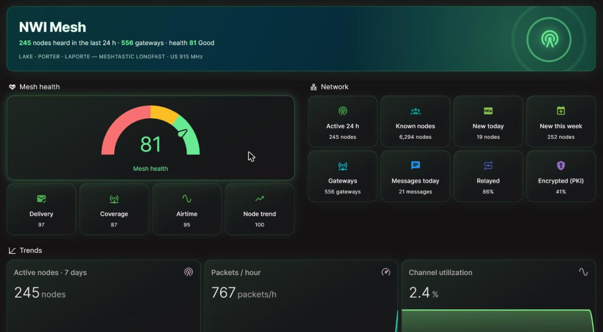

# NWI Mesh for Home Assistant

Put the NWI Mesh Meshtastic network on your Home Assistant dashboard: live
network health from HopWatch, plus a **Messages** tab that shows public channel
chat as the mesh hears it. You don't need a radio.

## What you get

**Network tab** (from the public HopWatch stats API)
- Mesh health score and its sub-scores, active/known/new nodes, gateways,
  packets, packet rate and channel utilization (latest hour), delivery ratio,
  relayed share, messages today, PKI-encrypted node share, MQTT brokers up,
  and open anomaly flags (a count of unresolved pubkey-spoof detections; 0 = clean)
- Connectivity: HopWatch reachable, NWIMesh broker up

**Messages tab** (live from MQTT)
- A rolling chat feed of public channel messages, showing sender name, time,
  hops and SNR
- `event.nwi_mesh_message` and an `nwimesh_message` bus event for automations,
  for example a phone alert when someone mentions your callsign
- Only the channels you list are decoded (LongFast by default). Direct
  messages and private channels stay encrypted and are never shown.

**Settings in the UI.** Point it at any HopWatch URL or any Meshtastic MQTT
server, root topic and channel keys, so it works for neighbouring meshes too.

## Install

### 1. Integration (recommended)

**HACS:** *HACS → ⋮ → Custom repositories*, add this repo as an *Integration*,
install **NWI Mesh**, and restart Home Assistant.
**Manual:** copy `custom_components/nwimesh` into `/config/custom_components/`
and restart.

Then go to *Settings → Devices & services → Add integration → NWI Mesh*. The
defaults are already set for NWI Mesh:

| Setting | Default |
|---|---|
| HopWatch URL | `https://hopwatch.nwimesh.net` (blank = no stats) |
| MQTT server / port | `mqtt.nwimesh.net` / `1883` (blank = no messages) |
| Username / password | the public `meshdev` login from [nwimesh.net/mqtt-settings](https://nwimesh.net/mqtt-settings) |
| Root topic | `msh/US/IN/NWI` |
| Channels | `LongFast=AQ==, LongTurbo=AQ==` (name=key as shown in the Meshtastic app) |
| Messages to keep | 50 |

You can change any of these later from the integration's **Configure** button.

### 2. Dashboard

Go to *Settings → Dashboards → Add dashboard → New dashboard from scratch*.
Open it, then *✏️ → ⋮ → Raw configuration editor*, and paste one of these:
- `dashboards/nwimesh-pro.yaml`: an animated radar banner, a health glow,
  glass tiles and chat bubbles. Needs
  [card-mod](https://github.com/thomasloven/lovelace-card-mod) and
  [mini-graph-card](https://github.com/kalkih/mini-graph-card) from HACS.
- `dashboards/nwimesh-stock.yaml`: the same layout with built-in cards only.

The dashboards assume the integration is named "NWI Mesh", which gives
entities `sensor.nwi_mesh_*`.

### 3. Alerts (optional)

Import `blueprints/nwimesh_health_alert.yaml` under *Settings → Automations →
Blueprints → Import*. It notifies you when mesh health drops or the broker
goes down.

### Lite option: no custom integration

If you only want the stats, `packages/nwimesh.yaml` creates the same
Network-tab sensors with Home Assistant's built-in REST integration. It has no
Messages tab. Don't install both.

## Be kind to the servers

Stats are polled every 5 minutes. The API is cached for 60 s and rate-limited
to 30 requests/min per IP. Messages arrive over a single MQTT subscription, so
there's no polling. Health sub-scores can be unavailable while HopWatch is
still gathering evidence, and broker counters reset when HopWatch is
redeployed. API source: [W9MDM/HopWatch](https://github.com/W9MDM/HopWatch).

## Privacy

The stats API returns network-wide totals only. The Messages tab shows the
same public-channel traffic that any Meshtastic radio on LongFast receives.
Nothing is sent from your Home Assistant to the mesh.

---
Community project of [NWI Mesh Net](https://nwimesh.net) · Questions:
[Discord](https://discord.gg/4wQ5SWPBfQ)
